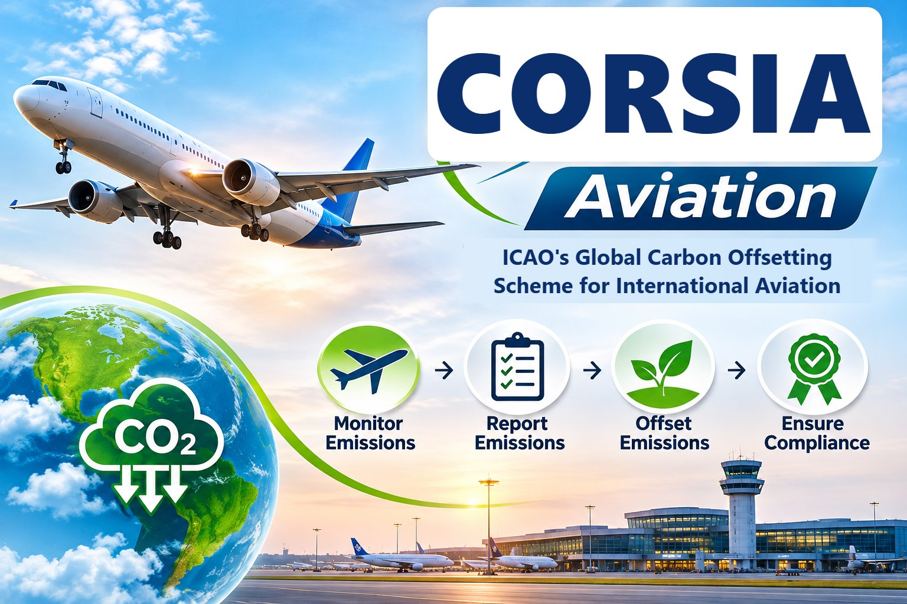

# Publishing details

**SEO Title:** CORSIA Aviation: The Global Carbon Framework for Airlines

**Meta Description:** CORSIA aviation explained: how ICAO's scheme fits with fuels and technology, which flights it covers, how MRV and offsetting work, and eligible units.

**URL Slug:** corsia-aviation-global-carbon-framework

**Primary Keyword:** CORSIA Aviation

**Secondary Keywords:** CORSIA Aviation Scheme, CORSIA Carbon Credits, International Aviation Carbon Emissions, Carbon Offsetting in Aviation, ICAO CORSIA Framework, CORSIA Compliance for Airlines, Aviation Carbon Reduction, CORSIA Eligible Emissions Units, Sustainable Aviation and Carbon Credits

**Featured image:** corsia-aviation-featured.jpg (1536 × 1024)
**Image alt text:** Infographic of CORSIA aviation, ICAO's global carbon offsetting scheme for international aviation, showing an aircraft, a globe and four steps: monitor emissions, report emissions, offset emissions and ensure compliance.

**Backlink:** one contextual link, anchor "CORSIA Carbon Credits", to https://corsiacarboncredit.in/ (in the section "How Carbon Credits Support CORSIA Aviation Compliance").

---

# CORSIA Aviation: Understanding the Global Carbon Reduction Framework for Airlines

## Introduction to CORSIA and the Aviation Industry

Aviation has a problem that few other industries share. A cement plant can switch fuels, a power station can be replaced by wind farms, but a long-haul aircraft still needs dense liquid fuel, and the cleaner alternatives are years away from replacing it at scale. At the same time, demand for international travel keeps growing.

So the sector's climate strategy rests on a mix of approaches: better aircraft, smarter flying, cleaner fuels, and, for the emissions that remain, a global offsetting scheme. That scheme is **CORSIA**. This article looks at **CORSIA aviation** from the industry's point of view: where it fits among the other measures, what it asks of airlines, and why it is not a substitute for cutting emissions directly.

## What Is CORSIA in Aviation?

**CORSIA** stands for the **Carbon Offsetting and Reduction Scheme for International Aviation**. It was adopted by the **International Civil Aviation Organization (ICAO)** at its 39th Assembly in 2016, and its rules are set out in **Annex 16, Volume IV** to the Chicago Convention.

In short, the **CORSIA aviation scheme**:

- requires airlines to **monitor, report and verify** CO₂ from their international flights
- requires them to **offset growth** in those emissions above a baseline, on routes between participating States
- settles offsetting through **CORSIA Eligible Emissions Units**, carbon credits that meet ICAO's criteria

It is **not** a scheme for domestic flights, and it does **not** require airlines to offset all of their emissions.

## Why Does the Aviation Industry Need CORSIA?

- **Growing emissions.** Aviation is commonly estimated to account for around 2–3% of global CO₂ emissions, and international traffic is expected to keep growing.
- **A gap in climate rules.** Under the Paris Agreement, countries report emissions within their borders. **International aviation carbon emissions** do not belong neatly to any one country.
- **Avoiding a patchwork.** Without a global measure, airlines could face many different national taxes and schemes on the same routes.
- **Bridging a technology gap.** New aircraft and cleaner fuels take time to deploy. Offsetting addresses growth in the meantime.

CORSIA gives the sector **one common framework**, agreed by governments through ICAO.

## How Does CORSIA Work for International Airlines?

ICAO describes its climate strategy as a **basket of measures**. CORSIA is one of four:

- **Aircraft technology:** more fuel-efficient aircraft and engines, supported by ICAO's CO₂ standard for new aircraft.
- **Operational improvements:** more efficient routes, air traffic management and ground operations.
- **Sustainable aviation fuels:** fuels with lower life-cycle emissions, which can also reduce CORSIA obligations.
- **Market-based measures:** CORSIA itself.

### Reduction versus offsetting

This distinction matters:

- **Aviation carbon reduction** means burning less fuel or using cleaner fuel, so the aircraft itself emits less.
- **Carbon offsetting in aviation** means compensating for emissions by funding reductions or removals elsewhere, such as at a landfill or in a forest.

CORSIA mostly deals with the second. It does not make any aircraft emit less. That is why it works alongside the other three measures rather than replacing them.

### What airlines actually do

For an airline, CORSIA works in a yearly cycle:

1. **Monitor** fuel and CO₂ on all international flights.
2. **Report** the emissions to the national authority.
3. **Have the report verified** independently.
4. **Receive an offsetting requirement**, if any routes are covered.
5. **Cancel eligible units** to meet that requirement, by the compliance deadline.

### Which routes count

- **Domestic flights** are outside CORSIA.
- Flights between **two participating States** count towards offsetting.
- Flights involving a **non-participating State** are monitored and reported, but not offset.

## Role of ICAO in Aviation Carbon Reduction

ICAO is the UN agency for civil aviation, with **193 Member States**. Its role in the **ICAO CORSIA framework** includes:

- **Setting policy:** the ICAO Assembly agrees the scheme's design, baseline and phases.
- **Setting standards:** the ICAO Council adopts the detailed rules and updates them.
- **Approving units:** the Council decides which carbon-crediting programmes are eligible, based on advice from its **Technical Advisory Body (TAB)**.
- **Technical work:** the **Committee on Aviation Environmental Protection (CAEP)** develops methods, such as how to calculate emissions and life-cycle values for fuels.
- **Long-term goals:** in 2022, ICAO members adopted a **long-term aspirational goal of net-zero carbon emissions from international aviation by 2050**.

ICAO does not sell carbon credits or operate a market. **National authorities** carry out day-to-day oversight of their airlines.

## Understanding International Aviation Emissions

Aviation emissions are calculated from **fuel burned**. Burning one tonne of Jet-A or Jet-A1 fuel releases about **3.16 tonnes of CO₂**, the conversion factor ICAO uses.

What drives an airline's emissions:

- **distance flown** and **network size**
- **aircraft type and age**
- **load factors**, meaning how full each flight is
- **operational efficiency**, such as routing and taxiing
- **fuel type**, including any sustainable aviation fuel

International flights tend to be longer than domestic ones, so they burn more fuel per flight. Under CORSIA, the **baseline** for 2024 to 2035 is **85% of 2019 international aviation emissions**, and offsetting covers growth above that level.

## CORSIA Monitoring, Reporting and Verification Process

MRV has applied since **1 January 2019**. It covers aeroplane operators that:

- emit **more than 10,000 tonnes of CO₂ a year** from international flights
- use aeroplanes with a maximum take-off mass **above 5,700 kg**

Humanitarian, medical and firefighting flights are excluded.

The process:

- **Monitoring plan:** each airline's method is approved in advance by its national authority.
- **Monitoring:** fuel is measured or calculated flight by flight. Smaller operators may use ICAO's **CORSIA CO₂ Estimation and Reporting Tool (CERT)**, within set thresholds.
- **Reporting:** an annual emissions report, broken down by State pair.
- **Verification:** an **accredited independent verification body** checks the report.
- **Submission:** the national authority reviews it and shares the data with ICAO.

MRV applies **whether or not** an airline's routes are covered by offsetting, so it gives a consistent global picture of international aviation emissions.

## How Carbon Credits Support CORSIA Aviation Compliance

Once an airline's offsetting requirement is set, carbon credits are how it complies. Each eligible unit represents **one tonne of CO₂ equivalent** reduced or removed by a project, such as:

- capturing methane from waste
- protecting forests from clearing
- supplying cleaner household energy
- restoring forests that absorb CO₂

The airline buys these units and **cancels** them in the relevant registry, then reports the cancellation to its national authority. Simply buying credits is not enough.

This is where **sustainable aviation and carbon credits** meet. Airlines that use **CORSIA eligible fuels** reduce their offsetting requirement, so they need fewer units. Those that rely only on offsetting need more. Many airlines combine both. Understanding which credits qualify is a practical part of this planning, and guidance on [CORSIA Carbon Credits](https://corsiacarboncredit.in/) explains how eligible units are identified and used for aviation compliance.

## CORSIA Eligible Emissions Units and Their Importance

**CORSIA Eligible Emissions Units** are the only credits that count. They must meet two levels of requirements:

**Programme level**

- The programme must meet ICAO's **Emissions Unit Eligibility Criteria**, covering additionality, robust measurement, permanence, avoiding double counting and safeguards.
- It must be approved by the ICAO Council for the relevant compliance period.

**Unit level**

For the **first phase (2024–2026)**, units generally need:

- an activity start date on or after **1 January 2016**
- a vintage from **2021 to 2026**
- **host-country authorisation** with a **corresponding adjustment**, so the reduction is not also counted by the host country
- a **CORSIA label** in the registry

**Not every carbon credit qualifies.** Credits that are valid for a company's voluntary climate claim may not meet these conditions. ICAO's **"CORSIA Eligible Emissions Units"** document is the reference for current approvals.

Eligibility matters because supply is limited. IATA estimated first-phase demand at **200–250 million units**, while about **72 million** were covered by compatible host-country authorisations in August 2026.

## Benefits of CORSIA for the Global Aviation Industry

- **A single global framework**, reducing the risk of conflicting national measures
- **Consistent emissions data** across airlines and countries
- **Predictable rules** for long-term planning
- **An incentive for cleaner fuels**, which lower offsetting requirements
- **Climate finance** for emission reduction and removal projects worldwide
- **A credibility framework** for **CORSIA compliance for airlines**, through approved programmes and independent verification

## Challenges in Implementing CORSIA

- **Limited eligible supply**, especially units with host-country authorisation
- **Price volatility**, with first-phase units assessed at about US$19 in January 2026 and US$13 in November 2026 (Fastmarkets)
- **Uneven participation** during the voluntary phases
- **Questions about offset quality** and whether offsetting growth goes far enough
- **Complex due diligence** for airlines buying units
- **Slow scaling of sustainable aviation fuel**, which keeps offsetting important for now

## Future of Sustainable Aviation and Carbon Offsetting

**What is scheduled:**

- CORSIA's **second phase (2027–2035)** begins on 1 January 2027. Participation becomes mandatory for most States with significant international aviation, while least developed countries, small island developing states and landlocked developing countries are exempt unless they volunteer.
- Large aviation markets that did not volunteer earlier, such as India, will face offsetting from 2027.
- ICAO continues to review programmes and unit conditions for each compliance period.

**What may change:**

- **Sustainable aviation fuel** could take a larger share of the sector's climate effort, reducing reliance on offsets.
- **New aircraft technologies** may cut fuel burn further.
- **More authorised units** could ease supply if more host countries issue authorisations.
- **Carbon removals** could play a bigger role in eligible supply.

Over the long term, offsetting is expected to be a **bridge**, not a destination. The 2050 net-zero goal depends mainly on reducing the sector's own emissions.

## Conclusion

**CORSIA aviation** is best understood as one tool in a wider toolkit. ICAO's basket of measures combines better aircraft, more efficient operations and cleaner fuels with a market-based measure for the emissions that remain. CORSIA is that measure: it requires covered airlines to **monitor, report and verify** their international emissions, and to **offset growth above the baseline** on routes between participating States, using **CORSIA Eligible Emissions Units**.

It does not cover domestic flights, does not require airlines to offset every tonne, and does not accept every carbon credit. Most importantly, offsetting is not the same as reduction. For an industry aiming at net zero by 2050, CORSIA manages the growth of emissions today while the harder work of cutting them continues.

---

### Sources

- [ICAO – CORSIA Eligible Emissions Units](https://www.icao.int/CORSIA/corsia-eligible-emissions-units)
- [EASA – ICAO Carbon Offsetting and Reduction Scheme for International Aviation (CORSIA)](https://www.easa.europa.eu/en/domains/environment/icao-carbon-offsetting-and-reduction-scheme-international-aviation-corsia)
- [IATA – CORSIA fact sheet](https://www.iata.org/en/iata-repository/pressroom/fact-sheets/fact-sheet-corsia/)
- [ICCT – India aviation emissions inventory and CORSIA (working paper, September 2026)](https://theicct.org/wp-content/uploads/2026/08/ID-628-%E2%80%93-India-CORSIA_working-paper_final.pdf)
- [IATA / EuropaWire – ICAO joins alliance to address CORSIA supply shortfall (13 October 2026)](https://news.europawire.eu/icao-joins-iata-backed-alliance-to-address-corsia-emissions-unit-supply-shortfall/eu-press-release/2026/10/13/18/41/08/182827/)
- [Fastmarkets – CORSIA prices tick higher on increased buyer inquiries (November 2026)](https://www.fastmarkets.com/insights/corsia-prices-tick-higher-on-increased-buyer-inquiries-despite-overall-airline-buying-remaining-measured/)
