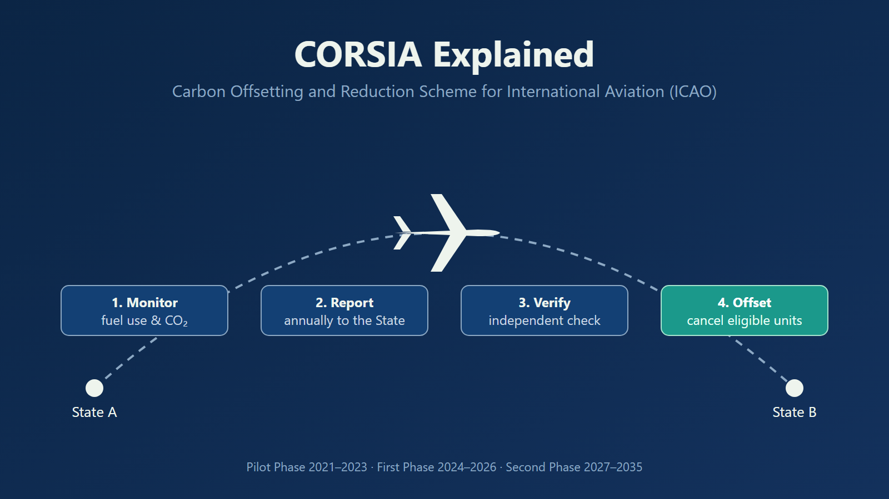

# Publishing details

**SEO Title:** CORSIA: Carbon Offsetting and Reduction Scheme Explained

**Meta Description:** CORSIA is ICAO's Carbon Offsetting and Reduction Scheme for International Aviation. Learn how its phases, MRV rules and eligible emissions units work.

**URL Slug:** corsia-carbon-offsetting-and-reduction-scheme

**Primary Keyword:** CORSIA Carbon Offsetting and Reduction Scheme

**Secondary Keywords:** Carbon Offsetting and Reduction Scheme for International Aviation, CORSIA Meaning, CORSIA Full Form, CORSIA Aviation Regulations, CORSIA Compliance, CORSIA Eligible Emissions Units, Aviation Carbon Offsetting, International Aviation Emissions, CORSIA Carbon Credits

**Featured image:** corsia-featured-image.png (1600 × 900)
**Image alt text:** Diagram of an international flight between two States with the four CORSIA steps: monitor, report, verify and offset.

---

# CORSIA: Carbon Offsetting and Reduction Scheme for International Aviation Explained

The **CORSIA Carbon Offsetting and Reduction Scheme** is the global market-based measure that the International Civil Aviation Organization (ICAO) uses to address carbon dioxide (CO₂) emissions from international flights. Airlines monitor, report and verify the CO₂ from their international flights each year. Where the rules apply, they offset part of those emissions by cancelling eligible emissions units. The scheme runs in phases until 2035, and its second phase, which most large aviation States must join, starts on 1 January 2027.

This guide explains how the scheme works, who it covers and where carbon credits fit in.

## What Is CORSIA and What Does Carbon Offsetting and Reduction Scheme Mean?

**CORSIA stands for Carbon Offsetting and Reduction Scheme for International Aviation.** ICAO Member States agreed to create it at the 39th ICAO Assembly in 2016. The detailed rules sit in ICAO's Standards and Recommended Practices (SARPs), in Annex 16, Volume IV to the Chicago Convention, which has applied since 1 January 2019.

Here is a simple way to think about it. The scheme takes a baseline level of international aviation CO₂. Once emissions on covered routes grow above that baseline, aeroplane operators have to compensate for their share of the growth. They do this by buying and cancelling emissions units that represent emission reductions or removals achieved elsewhere in the economy.

CORSIA covers **international aviation only**, meaning flights that depart from one country and arrive in another. Domestic flights are counted in each country's national climate commitments under the Paris Agreement and are not part of CORSIA.

## Why Was CORSIA Introduced for International Aviation?

Air travel has grown quickly for decades, and demand has largely recovered from the pandemic downturn. According to the International Energy Agency (IEA), aviation produces roughly 2–3% of global energy-related CO₂ emissions. Most of the sector's fuel is burned on international routes.

Aviation is hard to decarbonise:

- Jet engines rely on dense liquid fuel, and aircraft stay in service for decades.
- Sustainable aviation fuel (SAF) is still a small and expensive share of supply.
- New propulsion technologies, such as hydrogen or electric aircraft, are not ready for long-haul flying.

International flights also create a policy problem. Emissions over international airspace don't belong neatly to any one country. If countries each regulated these flights differently, airlines would face a patchwork of overlapping rules. ICAO, the UN agency for civil aviation, offered a forum where 190-plus States could agree on one common framework.

CORSIA is meant to **complement direct emission reductions, not replace them**. ICAO describes a "basket of measures": aircraft technology, operational improvements, sustainable aviation fuels and market-based measures. CORSIA is the market-based part, and it covers emissions that the other measures cannot yet remove.

## How Does the CORSIA Carbon Offsetting and Reduction Scheme Work?

CORSIA follows a yearly cycle of monitoring, reporting and verification (MRV), combined with offsetting over multi-year compliance periods.

1. **Identify applicable operators and flights.** MRV applies to aeroplane operators that emit more than 10,000 tonnes of CO₂ a year from international flights using aircraft over 5,700 kg maximum take-off mass. Humanitarian, medical and firefighting flights are excluded.
2. **Prepare an Emissions Monitoring Plan** that sets out how fuel use will be measured. The plan is approved by the State the operator is attributed to.
3. **Monitor fuel use and calculate CO₂.** Operators convert fuel burned into CO₂ using ICAO's fuel-specific factors. Smaller emitters may use ICAO's CORSIA CO₂ Estimation and Reporting Tool (CERT).
4. **Submit an annual Emissions Report** to the State, due by 30 April for the previous year.
5. **Arrange independent verification** by an accredited verification body.
6. **Determine offsetting requirements.** The State calculates each operator's obligation for flights between participating States.
7. **Acquire eligible emissions units** that meet ICAO's criteria for the relevant compliance period.
8. **Cancel the units** in an approved registry and report the cancellation to the State by ICAO's deadline.

### CORSIA Implementation Workflow Table

| Stage | Purpose | Responsible party |
|---|---|---|
| Applicability check | Confirm whether the operator and its international flights fall within scope | Aeroplane operator, with its State |
| Emissions Monitoring Plan | Fix the method for measuring fuel and CO₂ | Operator prepares; State approves |
| Monitoring | Record fuel use per international flight | Operator |
| Annual Emissions Report | Disclose verified CO₂ for the year | Operator submits to its State |
| Verification | Independently confirm the data is accurate | Accredited verification body |
| Offsetting calculation | Work out the units owed for routes between participating States | State, using ICAO data |
| Unit acquisition | Obtain CORSIA-eligible emissions units | Operator |
| Cancellation and reporting | Retire units and prove compliance | Operator, then State reports to ICAO |

## What Are the Different Phases of CORSIA Implementation?

CORSIA runs from 2021 to 2035 in three phases:

| Phase | Years | Participation |
|---|---|---|
| Pilot Phase | 2021–2023 | Voluntary for States |
| First Phase | 2024–2026 | Voluntary for States |
| Second Phase | 2027–2035 | Required for most States, with exemptions |

**Voluntary phases.** Participation grew steadily. ICAO reports that 126 States took part when the First Phase began in 2024 and 130 States in 2026. ICAO lists 134 States for 2027.

**Second Phase.** From 2027, a State must participate if its share of international revenue tonne-kilometres (RTK) in 2018 was above 0.5% of the world total, or if it falls within the list of States that together make up 90% of total RTKs. Least developed countries, small island developing States and landlocked developing countries are exempt unless they volunteer.

**Baseline changes.** The COVID-19 collapse in traffic forced ICAO to revise the baseline. For the pilot phase, it used 2019 emissions. From 2024 onwards, the baseline is 85% of 2019 CO₂ emissions, as agreed at the 41st ICAO Assembly in 2022.

**MRV versus offsetting.** This is the most important distinction:

- **Monitoring, reporting and verification** apply to all in-scope operators on all international flights, whether or not their States participate in offsetting.
- **Offsetting obligations** apply only to flights between two participating States. A flight to or from a non-participating State is still reported but carries no offsetting requirement.

The authoritative list of covered routes is ICAO's annual *CORSIA States for Chapter 3 State Pairs* document. Operators should check it every year.

## What Role Do Carbon Credits Play in CORSIA Compliance?

Under CORSIA, carbon credits are formally called **CORSIA Eligible Emissions Units**. Operators use these units to meet any offsetting requirement that remains after taking account of CORSIA-eligible fuels.

Eligibility is decided at several levels:

- **Programme level.** ICAO's Technical Advisory Body (TAB) assesses carbon-crediting programmes against the CORSIA Emissions Unit Criteria. The ICAO Council then approves them for specific compliance periods. ICAO's *CORSIA Eligible Emissions Units* document listed ten programmes approved for the First Phase in 2026. Approved programmes include the American Carbon Registry, ART, Climate Action Reserve and Global Carbon Council.
- **Scope and methodology.** Each approval comes with a defined scope. Some activity types, methodologies or project dates can be excluded.
- **Vintage and dates.** First Phase units generally have to come from activities starting on or after 1 January 2016, with emission reductions occurring between 2021 and 2026.
- **Host-country authorisation.** First Phase units need a host-country Letter of Authorization and a commitment to apply corresponding adjustments, so the same reduction is not claimed twice.
- **Registry labelling.** Units must be issued and tagged as CORSIA eligible in the programme's designated registry.

**Programme approval does not make every unit from that programme eligible.** A credit from an approved standard can still fail on vintage, methodology, missing authorisation or labelling. Buyers need to check each unit.

Practical support is helpful at this stage. Sourcing units, checking authorisation status and keeping cancellation records can all be complex. Resources on [CORSIA Carbon Credits](https://corsiacarboncredit.in/) explain how eligible units are assessed and acquired for airline compliance.

After acquisition, the operator **cancels** the units in the registry, recording CORSIA as the purpose. It then submits an Emissions Unit Cancellation Report to its State. For the First Phase compliance period, the cancellation deadline is 31 January 2028. CORSIA itself is not a central exchange. Units move through programme registries and bilateral or broker transactions.

### Voluntary Carbon Credits vs CORSIA-Eligible Emissions Units

| Feature | General voluntary carbon credits | CORSIA-eligible emissions units |
|---|---|---|
| Main use | Voluntary corporate or personal climate claims | Meeting airline offsetting obligations under CORSIA |
| Who sets eligibility | The issuing standard and the buyer's own policy | ICAO Council, on TAB recommendations |
| Programme approval | Not required | Programme must be approved for that compliance period |
| Vintage rules | Set by buyer preference | Fixed date windows for each phase |
| Host-country authorisation | Often not required | Required for First Phase units, with corresponding adjustment |
| Registry status | Standard issuance | Must be labelled CORSIA eligible in a designated registry |
| Retirement | Retired for a voluntary claim | Cancelled for CORSIA and reported to the State |

## What Is the Future of CORSIA and Sustainable Aviation?

**Confirmed policy developments**

- In 2022, ICAO adopted a long-term global aspirational goal (LTAG) of net-zero carbon emissions from international aviation by 2050.
- In 2023, ICAO's third Conference on Aviation and Alternative Fuels (CAAF/3) agreed a goal to reduce the carbon intensity of international aviation fuel by 5% by 2030, through SAF, lower-carbon aviation fuels and other cleaner energy.
- In 2025, the 42nd ICAO Assembly adopted Resolution A42-22. It confirmed CORSIA as the only global market-based measure for international aviation and took note of the 2025 periodic review of supply, demand and prices for eligible fuels and units.
- CORSIA-eligible fuels that meet ICAO's sustainability criteria already reduce an operator's offsetting requirement.

**Projections and industry expectations**

- Demand for eligible units is expected to rise sharply in the second phase. ICAO and IATA have both warned that supply is constrained, mainly because of the authorisation and corresponding-adjustment requirements.
- IATA's member airlines committed in 2021 to net-zero carbon emissions by 2050. The industry expects SAF to deliver the largest share, with efficiency gains, new aircraft and operational improvements also contributing.
- ICAO must decide in later reviews whether CORSIA continues beyond 2035, and in what form. Some stakeholders have discussed an extension, but no decision has been made.

Integrity of the carbon market will shape how credible CORSIA is. Strong unit criteria, transparent registries and alignment with Article 6 of the Paris Agreement all affect whether offsetting delivers real climate benefits.

## Frequently Asked Questions

**1. What is the full form of CORSIA?**
CORSIA stands for Carbon Offsetting and Reduction Scheme for International Aviation, developed by ICAO.

**2. What is the main purpose of the Carbon Offsetting and Reduction Scheme for International Aviation?**
It addresses growth in CO₂ emissions from international flights above an agreed baseline. Operators offset that growth using eligible emissions units, alongside technology, operations and fuel measures.

**3. Which airlines are required to participate in CORSIA?**
Operators emitting over 10,000 tonnes of CO₂ a year from international flights with aircraft above 5,700 kg must monitor, report and verify their emissions. Offsetting applies only to flights between participating States, and participation becomes required for most States from 2027.

**4. How are carbon credits used under CORSIA?**
Operators buy CORSIA-eligible emissions units, cancel them in an approved registry, and report the cancellation to their State. This meets their offsetting requirement for a compliance period.

**5. Are all voluntary carbon credits eligible for CORSIA compliance?**
No. A unit must come from an ICAO-approved programme, fall within its approved scope and vintage window, meet the authorisation requirements and be labelled CORSIA eligible.

## Conclusion

The **CORSIA Carbon Offsetting and Reduction Scheme** gives international aviation one shared, ICAO-backed way to measure its CO₂ and offset growth. The second phase brings mandatory participation for most States from 2027, so accurate MRV and careful unit selection will matter more than ever. CORSIA is not a substitute for cleaner fuels and aircraft. It is one part of aviation's wider path to net zero.

## References

1. ICAO – CORSIA overview and news: https://www.icao.int/CORSIA/news
2. ICAO – CORSIA Eligible Emissions Units: https://www.icao.int/CORSIA/corsia-eligible-emissions-units
3. ICAO – CORSIA Eligible Emissions Units document (April 2026): https://www.icao.int/sites/default/files/environmental-protection/CORSIA/Documents/CORSIA%20Eligible%20Emissions%20Units/CORSIA-Eligible-Emissions-Units_April-2026.pdf
4. ICAO – CORSIA States for Chapter 3 State Pairs: https://www.icao.int/corsia-states-chapter-3-state-pairs
5. ICAO – CORSIA Newsletter, January 2026: https://www.icao.int/sites/default/files/environmental-protection/CORSIA/Newsletter/CORSIA-Newsletter_January-2026.pdf
6. ICAO – Expansion of approved emissions unit programmes: https://www.icao.int/news/icao-expands-approved-emissions-unit-programmes-effective-corsia-implementation
7. IATA – CORSIA fact sheet: https://www.iata.org/en/iata-repository/pressroom/fact-sheets/fact-sheet-corsia/
8. IATA – ICAO 42nd Assembly key environment-related outcomes: https://www.iata.org/en/iata-repository/publications/economic-reports/icao-42nd-assembly-key-environment-related-outcomes
9. IEA – Aviation: https://www.iea.org/energy-system/transport/aviation
