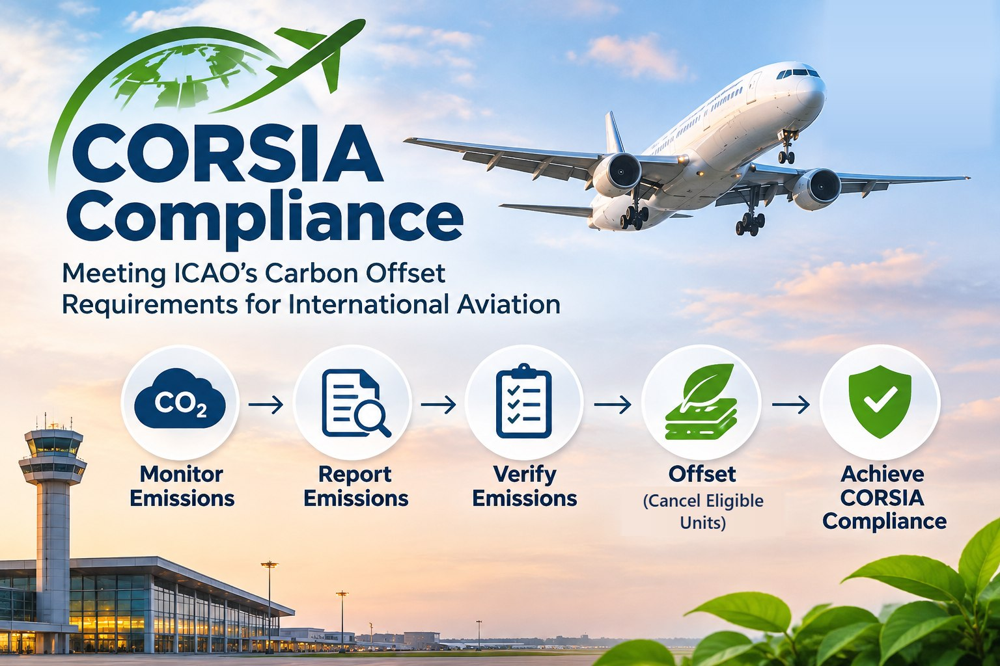

# Publishing details

**SEO Title:** CORSIA Compliance: How Airlines Meet Offsetting Obligations

**Meta Description:** CORSIA compliance explained: who must comply, MRV duties, how offset requirements are calculated, eligible units, deadlines and best practices for airlines.

**URL Slug:** corsia-compliance-airline-obligations

**Primary Keyword:** CORSIA Compliance

**Secondary Keywords:** CORSIA Compliance Requirements, CORSIA Carbon Credits, CORSIA Requirements for Airlines, ICAO CORSIA Framework, CORSIA Eligible Emissions Units, Aviation Carbon Compliance, CORSIA Emissions Reporting, CORSIA Monitoring and Verification, International Aviation Carbon Offsetting

**Featured image:** corsia-compliance-featured.jpg (1536 × 1024)
**Image alt text:** Infographic of CORSIA compliance for airlines: monitor emissions, report emissions, verify emissions, offset by cancelling eligible units, and achieve CORSIA compliance.

**Backlink:** one contextual link, anchor "CORSIA Carbon Credits", to https://corsiacarboncredit.in/ (in the section "How Carbon Credits Help Airlines Meet Compliance Obligations").

---

# CORSIA Compliance: How Airlines Meet International Aviation Carbon Reduction Obligations

## Introduction to CORSIA Compliance

When an auditor reviews an airline's climate obligations, the questions are rarely philosophical. Was the fuel on this flight recorded correctly? Which State pair does this route belong to? Was this carbon credit labelled for the right compliance period, and when was it cancelled?

**CORSIA compliance** is built on precise answers to questions like these. This article explains what compliance means under the international aviation offsetting scheme, which obligations apply to which airlines, how the numbers are worked out, and how airlines can manage the process without last-minute surprises.

## What Does CORSIA Compliance Mean?

**CORSIA**, the **Carbon Offsetting and Reduction Scheme for International Aviation**, is the global market-based measure adopted by the **International Civil Aviation Organization (ICAO)** in 2016. Its rules are set out in **Annex 16, Volume IV** to the Chicago Convention.

For an airline, **CORSIA compliance** means meeting every obligation that applies to it under those rules, as implemented by its own State. In practice, that has two parts:

- **MRV compliance:** monitoring, reporting and verifying CO₂ emissions from international flights every year.
- **Offsetting compliance:** cancelling enough **CORSIA Eligible Emissions Units** to cover any offsetting requirement, by the deadline for each compliance period.

**The two are not the same.** Many airlines must monitor and report, but have small or no offsetting obligations, depending on where they fly and which States participate.

## Why Is CORSIA Compliance Important for Airlines?

- **It is a legal obligation.** States implement CORSIA through national law, and national authorities can apply penalties for non-compliance.
- **It affects costs.** Offsetting requirements translate into purchases of eligible units, whose prices move with supply and demand.
- **It affects reputation.** Investors, regulators and passengers increasingly look at how airlines handle climate obligations.
- **It is growing.** From **2027**, participation becomes mandatory for most States with significant international aviation, bringing many more routes into offsetting.
- **It underpins the sector's climate goals.** ICAO members have adopted a long-term aspirational goal of **net-zero carbon emissions from international aviation by 2050**, and CORSIA is one of the measures supporting that path.

## Who Is Required to Follow CORSIA Regulations?

**CORSIA requirements for airlines** depend on three things: the size of the operator, the type of flight and the States involved.

### Operators covered by MRV

- aeroplane operators with **more than 10,000 tonnes of CO₂ a year** from international flights
- using aeroplanes with a maximum take-off mass **above 5,700 kg**

### Flights outside the scheme

- **domestic flights** within one State
- **humanitarian, medical and firefighting** flights

### Offsetting coverage

Offsetting applies only to emissions on **routes between two States that both participate** in offsetting in that year. **New entrants** are exempt for their first three years, or until they reach 0.1% of total international revenue tonne kilometres.

### A mixed-network example (hypothetical)

A mid-sized airline flies 30 international routes:

- 18 routes link its home State with other **participating States**. These emissions count towards offsetting.
- 12 routes go to **non-participating States**. These are monitored, reported and verified, but **not offset**.

If several of those 12 destination States join CORSIA in 2027, the airline's offsetting exposure rises, even if its network does not change.

## Key Compliance Obligations Under the ICAO Framework

The **ICAO CORSIA framework** creates a sequence of obligations:

- **Emissions Monitoring Plan:** submitted to and approved by the national authority, describing how fuel and emissions will be monitored.
- **Annual monitoring:** fuel data collected for every international flight.
- **Annual Emissions Report:** verified by an accredited body and submitted to the national authority, generally by **30 April** of the following year.
- **Offsetting requirement:** calculated by the national authority for each year of a compliance period.
- **Eligible fuel claims:** optional, to reduce the requirement, with supporting evidence.
- **Unit cancellation:** cancelling eligible units in programme registries before the compliance deadline.
- **Emissions Unit Cancellation Report:** submitted to the national authority, verified, as the final proof of compliance.

## CORSIA Emissions Monitoring, Reporting and Verification

### Monitoring

Airlines measure fuel use flight by flight, using one of the **fuel use monitoring methods** approved in ICAO's rules, as set out in their monitoring plan. Smaller emitters may be allowed to use ICAO's **CORSIA CO₂ Estimation and Reporting Tool (CERT)**, within defined thresholds.

### CORSIA emissions reporting

The annual Emissions Report gives:

- total CO₂ from international flights
- emissions for each **State pair**, which determines which routes are covered by offsetting
- any claims for **CORSIA eligible fuels**

### Verification

**CORSIA monitoring and verification** rely on independence:

- Reports are checked by a **verification body accredited** to international greenhouse gas verification standards.
- The verifier examines the data, methods and calculations, and confirms the report is free of material misstatement.
- The national authority reviews the verified report and passes data to ICAO.

**MRV has applied since 2019**, regardless of whether an airline's State participates in offsetting.

## How Airlines Calculate Their CORSIA Offset Requirements

The airline does not choose its own offset amount. The **national authority** calculates it from verified data.

**Step 1: Calculate emissions on covered routes.**
Fuel burned is converted to CO₂ using ICAO's conversion factors. For Jet-A and Jet-A1 fuel, that is **3.16 tonnes of CO₂ per tonne of fuel**. Only emissions on routes between participating States are used.

**Step 2: Apply the growth factor.**
The baseline for 2024 to 2035 is **85% of 2019 emissions**. Covered emissions are multiplied by a **growth factor**, which reflects growth above that baseline:

- until **2032**, the factor is based fully on the **sector's** growth
- from **2033 to 2035**, it is **85% sectoral and 15% based on the airline's own growth**

**Step 3: Subtract eligible fuel reductions.**
Airlines using **CORSIA eligible fuels**, such as qualifying sustainable aviation fuel, can claim reductions.

**Worked example (hypothetical figures):**

- Covered-route emissions for a year: **320,000 tonnes**
- Assumed sectoral growth factor: **0.04**
- Gross requirement: 320,000 × 0.04 = **12,800 tonnes**
- Eligible fuel reduction: **800 tonnes**
- Final requirement: **12,000 tonnes**

The airline therefore owes 12,000 eligible units for that year, a small fraction of its total emissions. *These values are illustrative and are not actual ICAO growth factors.*

## Role of CORSIA Eligible Emissions Units

**CORSIA Eligible Emissions Units** are the only instrument that settles an offsetting requirement. Each generally represents **one tonne of CO₂ equivalent** reduced or removed by a project.

A unit is eligible only if:

- its **programme** is approved by the **ICAO Council**, advised by the **Technical Advisory Body**, for the compliance period
- it meets the period's **unit conditions**. For the **first phase (2024–2026)**, these generally include an activity start date on or after 1 January 2016, a vintage from 2021 to 2026, **host-country authorisation** with a **corresponding adjustment**, and a **CORSIA label** in the registry

ICAO's **"CORSIA Eligible Emissions Units"** document sets out the current list of approved programmes and conditions. It is the reference point for every purchase.

## How Carbon Credits Help Airlines Meet Compliance Obligations

Eligible carbon credits are how **international aviation carbon offsetting** works in practice. Each unit cancelled represents a tonne of emissions reduced or removed elsewhere, for example by methane capture, forest protection or cleaner cooking projects, compensating for a tonne of growth in aviation emissions.

Airlines typically use a mix of strategies:

- **Spot purchases** of units already labelled as eligible.
- **Forward agreements**, contracting future eligible supply at agreed prices.
- **Portfolio diversification** across programmes, countries and project types, to reduce delivery risk.
- **Combining units with eligible fuels**, which reduce the number of units needed.

Choosing the right units is where many compliance problems start or end. Guidance on [CORSIA Carbon Credits](https://corsiacarboncredit.in/) explains how eligible units are identified, checked and documented as part of an airline's offsetting strategy.

**Buying is not complying.** The obligation is met only when units are **cancelled** in the registry and reported to the national authority before the deadline. For the first phase, that deadline falls in **January 2028**.

## Challenges in Achieving CORSIA Compliance

- **Tight eligible supply.** IATA estimated first-phase demand at **200–250 million units**, against about **72 million** covered by compatible host-country authorisations in August 2026.
- **Price volatility.** First-phase units were assessed at about **US$19** in January 2026 and **US$13** in November 2026 (Fastmarkets).
- **Changing participation.** The list of participating States, and therefore covered routes, changes over time.
- **Data quality.** Gaps in fuel records lead to verification findings and estimates.
- **Unit due diligence.** Every unit's programme, vintage, authorisation and label must be checked.
- **Timing.** Units must be secured and cancelled before a fixed deadline.
- **Rule updates.** ICAO revises unit conditions and programme approvals between phases.

## Best Practices for Effective CORSIA Compliance Management

- **Map route exposure.** Maintain an up-to-date list of which State pairs are covered by offsetting in each year.
- **Forecast requirements early.** Use network plans and published growth factors to estimate future obligations.
- **Invest in fuel data systems.** Automated, reconciled fuel records reduce verification issues.
- **Engage verifiers early.** Pre-verification reviews help resolve issues before deadlines.
- **Build a unit checklist.** For every unit, confirm programme approval, vintage, Letter of Authorisation, CORSIA label and registry serial numbers.
- **Diversify procurement.** Combine spot and forward purchases, and avoid relying on a single supplier or country.
- **Plan cancellation timing.** Leave enough time to cancel and report before the deadline.
- **Keep a full audit trail.** Retain monitoring data, reports, contracts and cancellation records.
- **Assign clear ownership.** Make specific teams responsible for MRV, procurement and reporting.

## Future of Aviation Carbon Compliance

**What is confirmed:**

- The **second phase (2027–2035)** begins on **1 January 2027**, with mandatory participation for most States with significant international aviation. Least developed countries, small island developing states and landlocked developing countries are exempt unless they volunteer.
- The first compliance period of the second phase runs from **2027 to 2029**.
- Large markets that did not volunteer earlier, such as **India**, will face offsetting from 2027.

**What may develop:**

- more host countries issuing authorisations, which could ease supply
- greater use of **insurance** and compensation tools for units awaiting corresponding adjustments
- a larger role for **sustainable aviation fuel**, reducing the need for offsets
- further refinement of rules at future ICAO Assemblies and periodic reviews

**Aviation carbon compliance** will become more demanding, not less, as coverage widens and integrity expectations rise.

## Conclusion

**CORSIA compliance** is a cycle rather than a single action. Every covered airline must **monitor, report and verify** its international emissions each year. Only emissions on routes between participating States feed into an **offsetting requirement**, calculated by the national authority from growth above the baseline and reduced by eligible fuels. That requirement is settled only by cancelling **CORSIA Eligible Emissions Units** that meet ICAO's programme and unit conditions, and reporting the cancellation on time.

Airlines that map their route exposure, keep clean data and plan unit procurement well ahead of deadlines will be best placed as the scheme expands in 2027. The rules are demanding, but they are knowable, and careful preparation turns them from a risk into a routine.

---

### Sources

- [ICAO – CORSIA Eligible Emissions Units](https://www.icao.int/CORSIA/corsia-eligible-emissions-units)
- [EASA – ICAO Carbon Offsetting and Reduction Scheme for International Aviation (CORSIA)](https://www.easa.europa.eu/en/domains/environment/icao-carbon-offsetting-and-reduction-scheme-international-aviation-corsia)
- [IATA – CORSIA fact sheet](https://www.iata.org/en/iata-repository/pressroom/fact-sheets/fact-sheet-corsia/)
- [ICCT – India aviation emissions inventory and CORSIA (working paper, September 2026)](https://theicct.org/wp-content/uploads/2026/08/ID-628-%E2%80%93-India-CORSIA_working-paper_final.pdf)
- [IATA / EuropaWire – ICAO joins alliance to address CORSIA supply shortfall (13 October 2026)](https://news.europawire.eu/icao-joins-iata-backed-alliance-to-address-corsia-emissions-unit-supply-shortfall/eu-press-release/2026/10/13/18/41/08/182827/)
- [Fastmarkets – CORSIA prices tick higher on increased buyer inquiries (November 2026)](https://www.fastmarkets.com/insights/corsia-prices-tick-higher-on-increased-buyer-inquiries-despite-overall-airline-buying-remaining-measured/)
