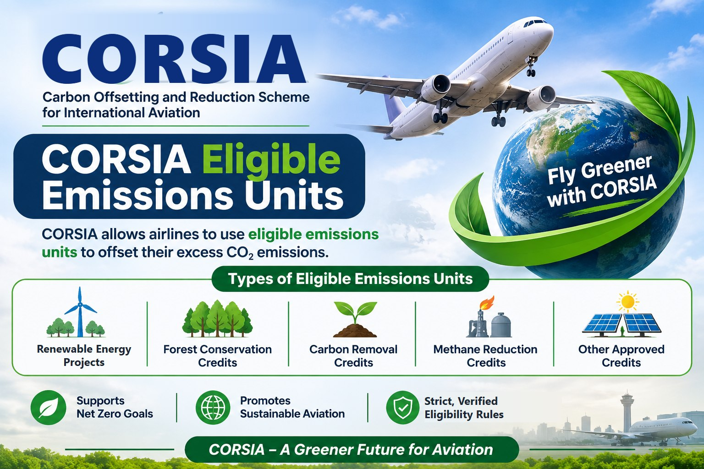

# Publishing details

**SEO Title:** CORSIA Eligible Emissions Units: What Airlines Can Use

**Meta Description:** CORSIA Eligible Emissions Units explained: how ICAO approves programmes, what makes a unit eligible, how airlines use them and how they differ from other credits.

**URL Slug:** corsia-eligible-emissions-units-explained

**Primary Keyword:** CORSIA Eligible Emissions Units

**Secondary Keywords:** CORSIA Eligible Emissions, CORSIA Approved Carbon Credits, CORSIA Carbon Credits, Eligible Emissions Units for Airlines, CORSIA Compliance Requirements, Carbon Offsetting in Aviation, ICAO CORSIA Framework

**Featured image:** corsia-eligible-emissions-units-featured.jpg (1536 × 1024)
**Image alt text:** Infographic of CORSIA eligible emissions units, with an aircraft over a globe and project types including renewable energy, forest conservation, carbon removal and methane reduction.

**Backlink:** one contextual link, anchor "CORSIA Carbon Credits", to https://corsiacarboncredit.in/ (in the section "How Airlines Meet CORSIA Offset Requirements").

---

# CORSIA Eligible Emissions Units: Understanding Approved Carbon Credits for Aviation Compliance

Picture two carbon credits from the same programme, the same country and even the same kind of project. One can be used by an airline to meet its obligations under international aviation rules. The other cannot. The difference is not the tonne of CO₂ each one represents. It is whether that unit meets the conditions ICAO has set for a specific compliance period.

That distinction sits at the heart of **CORSIA Eligible Emissions Units**, often shortened to EEUs. This article explains what they are, how a unit becomes eligible, and why airlines, suppliers and buyers need to check eligibility credit by credit rather than assuming it.

## What Are CORSIA Eligible Emissions Units?

**CORSIA Eligible Emissions Units are carbon credits that airlines are allowed to cancel to meet their offsetting requirements** under the Carbon Offsetting and Reduction Scheme for International Aviation (CORSIA).

CORSIA is the global market-based measure adopted by the International Civil Aviation Organization (ICAO) in 2016. Its rules sit in Annex 16, Volume IV to the Chicago Convention. Under the scheme, airlines on covered international routes must compensate for growth in CO₂ emissions above a baseline, currently set at **85% of 2019 emissions**.

Each eligible unit generally represents **one tonne of CO₂ equivalent** reduced or removed by a project somewhere in the world, such as a methane capture plant or a forest protection programme. But only units that pass ICAO's tests can be used for **CORSIA compliance requirements**. Everything else, however good, is simply a carbon credit.

## How Do Eligible Emissions Units Work Under CORSIA?

The process links a project on the ground to an airline's compliance report:

1. **A project generates credits** under a carbon-crediting programme, such as Verra or Gold Standard.
2. **The programme must be approved** by the ICAO Council for the relevant compliance period.
3. **The individual units must meet that period's conditions**, such as vintage and authorisation rules.
4. **The programme's registry labels the units** as CORSIA eligible.
5. **The airline buys and cancels** the units in the registry.
6. **The airline reports the cancellations** to its national authority, which reports to ICAO.

CORSIA runs in phases:

- a **pilot phase (2021–2023)**
- a **first phase (2024–2026)**
- a **second phase (2027–2035)**, which is mandatory for most States with significant international aviation

Each phase has its own unit eligibility conditions, so a unit that qualified for one phase may not qualify for the next.

**A simple example (hypothetical):** an airline flying between two participating States calculates an offsetting requirement of 50,000 tonnes for the first phase. It must cancel 50,000 units that are eligible for that phase. Units from an approved programme that are labelled for the pilot phase, or that lack the required authorisation, will not count.

## What Makes an Emissions Unit Eligible for CORSIA?

Eligibility has **two levels**, and both must be met.

### Programme level

The crediting programme must meet ICAO's **Emissions Unit Eligibility Criteria**. These cover:

- **governance and transparency**
- **registry systems** that track and cancel units securely
- **additionality**: reductions must go beyond business as usual
- **robust quantification** with realistic baselines
- **permanence**, with measures to address reversals
- **leakage** controls
- **avoiding double counting**, issuance and claiming
- **safeguards** against environmental and social harm

Programmes approved for the first phase include, among others, the **American Carbon Registry**, **Architecture for REDD+ Transactions**, the **Climate Action Reserve**, the **Global Carbon Council**, **Gold Standard** and **Verra**. Approvals often come with conditions, such as excluding certain methodologies.

### Unit level

Even within an approved programme, each unit must meet the conditions for the compliance period. For the **first phase (2024–2026)**, these generally include:

- **activity start dates** on or after 1 January 2016
- **vintages** from 2021 to 2026
- **host-country authorisation** for CORSIA use, through a Letter of Authorisation
- a commitment to a **corresponding adjustment** under Article 6 of the Paris Agreement, so the same reduction is not also counted towards the host country's own climate target
- **labelling** in the programme registry

Where a corresponding adjustment has not yet been confirmed, some programmes accept **approved insurance or compensation arrangements** that would replace the unit if the adjustment is never applied.

**The practical lesson:** programme approval alone does not make a credit eligible. ICAO publishes the current position in its **"CORSIA Eligible Emissions Units"** document, which should always be checked rather than relying on older lists.

## Role of ICAO in Approving Eligible Emissions Units

ICAO's role in the **ICAO CORSIA framework** is to set the rules, not to run a market.

- The **ICAO Council** decides which programmes are eligible for each compliance period.
- It acts on recommendations from the **Technical Advisory Body (TAB)**, a group of experts that assesses programmes against the eligibility criteria.
- Programmes apply, are assessed and may be approved, conditionally approved or asked to make changes.
- TAB also reviews programme changes after approval.

ICAO does **not** issue credits, sell them, set their price or operate a trading platform. Credits are created by programmes, traded through brokers, exchanges and direct deals, and cancelled in programme registries.

## Importance of Eligible Emissions Units for Airlines

For airlines, eligible units are the main tool for meeting offsetting obligations.

- **Compliance:** only eligible units count. Cancelling ineligible units leaves the obligation unmet.
- **Deadlines:** airlines must cancel units for the first phase by the deadline set by ICAO, which falls in early 2028.
- **Cost planning:** eligible units are scarcer than ordinary credits. IATA estimated first-phase demand at **200–250 million units**, while about **72 million units** were covered by compatible host-country authorisations in August 2026.
- **Price risk:** assessments for first-phase units have moved sharply. Fastmarkets put them at about **US$19.00** in January 2026 and **US$13.00** on 18 November 2026.
- **Reputation:** high-integrity units reduce the risk of criticism over weak offsets.

Airlines can also reduce their obligations by using **CORSIA eligible fuels**, such as qualifying sustainable aviation fuel, which lower the emissions they need to offset.

## Difference Between General Carbon Credits and CORSIA Eligible Units

| | General carbon credits | CORSIA eligible emissions units |
|---|---|---|
| **Main buyers** | Companies with voluntary climate targets | Airlines with CORSIA obligations |
| **Rules** | The issuing programme's rules | Programme rules plus ICAO conditions for the phase |
| **Vintage** | Any, depending on the buyer | Limited to the phase's window |
| **Host-country authorisation** | Usually not required | Required for first-phase units |
| **Registry status** | Issued | Issued and labelled as CORSIA eligible |
| **Typical price** | Lower on average | Assessed higher in 2026, but variable |

A credit can be perfectly valid for a company's voluntary claim and still be **unusable** for CORSIA. The reverse also matters: an eligible unit cancelled by an airline for compliance cannot be claimed by anyone else.

## How Airlines Meet CORSIA Offset Requirements

1. **Monitor, report and verify emissions.** Airlines with international emissions above 10,000 tonnes of CO₂ a year must monitor and report them each year, mostly from fuel use, with independent verification.
2. **Receive the offsetting requirement.** The national authority calculates it for emissions on routes between participating States, using ICAO's growth factors.
3. **Subtract eligible fuel benefits**, if the airline has used qualifying fuels.
4. **Source eligible units** from developers, traders, brokers or exchanges.
5. **Carry out due diligence:** check the programme approval, vintage, Letter of Authorisation, label and registry records for every unit.
6. **Cancel the units** in the relevant registry before the deadline.
7. **Report the cancellations** to the national authority.

Sourcing is often the hardest step, because labelled supply is limited and the checks are detailed. Resources on [CORSIA Carbon Credits](https://corsiacarboncredit.in/) explain how eligible units are assessed, sourced and documented for aviation compliance.

## Future Outlook for CORSIA Eligible Emissions Units

**What is already known:**

- The **second phase starts on 1 January 2027**, and its first compliance period runs from 2027 to 2029. More States, including large aviation markets such as India, will face offsetting requirements.
- ICAO will continue to assess programmes and set unit conditions for each period.
- The gap between airline demand and authorised supply has made **host-country authorisations** a central issue.

**What may develop, but is not certain:**

- more countries issuing authorisations and applying corresponding adjustments, which would increase supply
- greater use of **insurance** and compensation tools where adjustments are pending
- more **removal credits** entering the eligible supply
- continued price movement as supply and demand change

Anyone planning to buy or supply units for the second phase should follow ICAO's updates closely, because eligibility conditions can change between phases.

## Conclusion

**CORSIA Eligible Emissions Units** are not just carbon credits with a new name. They are units that have passed two tests: a programme approved by ICAO, and unit-level conditions for a specific compliance period, including vintage, host-country authorisation and registry labelling.

For airlines, that makes due diligence as important as price. For project developers and suppliers, it means a credit is only worth what it can be used for. And for anyone following **carbon offsetting in aviation**, it explains why eligible supply remains tight even in a market with plenty of ordinary credits.

The safest approach is simple: check ICAO's latest eligible units document, confirm every unit's label and authorisation in the registry, and never assume that a credit qualifies just because its programme does.

---

### Sources

- [ICAO – CORSIA Eligible Emissions Units](https://www.icao.int/CORSIA/corsia-eligible-emissions-units)
- [UNFCCC – Article 6 of the Paris Agreement](https://unfccc.int/process-and-meetings/the-paris-agreement/article-6)
- [Gold Standard – Article 6 and CORSIA labelling step-by-step guide](https://www.goldstandard.org/publications/article-6-and-corsia-labelling-step-by-step-guide)
- [Verra – The VCS under CORSIA](https://verra.org/programs/verified-carbon-standard/vcs-under-corsia/)
- [IATA / EuropaWire – ICAO joins alliance to address CORSIA supply shortfall (13 October 2026)](https://news.europawire.eu/icao-joins-iata-backed-alliance-to-address-corsia-emissions-unit-supply-shortfall/eu-press-release/2026/10/13/18/41/08/182827/)
- [Fastmarkets – CORSIA prices tick higher on increased buyer inquiries (November 2026)](https://www.fastmarkets.com/insights/corsia-prices-tick-higher-on-increased-buyer-inquiries-despite-overall-airline-buying-remaining-measured/)
