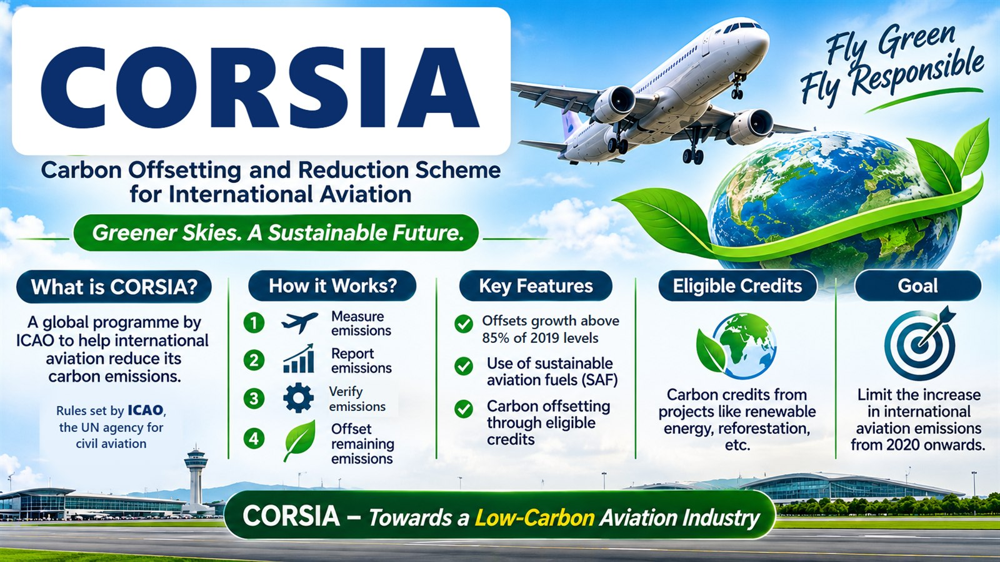

# Publishing details

**SEO Title:** What Is CORSIA? Global Aviation Carbon Offsetting Explained

**Meta Description:** What is CORSIA? Learn its full form, why ICAO created it, which flights it covers, how MRV and offsetting work, and what makes carbon credits eligible.

**URL Slug:** what-is-corsia-global-carbon-offsetting-scheme

**Primary Keyword:** CORSIA

**Secondary Keywords:** What Is CORSIA, CORSIA Full Form, CORSIA Carbon Credits, CORSIA Aviation Scheme, Carbon Offsetting and Reduction Scheme for International Aviation, ICAO CORSIA Framework, CORSIA Compliance, CORSIA Eligible Emissions Units, International Aviation Carbon Emissions, Carbon Offsetting in Aviation

**Featured image:** corsia-global-scheme-featured.jpg (1600 × 900)
**Image alt text:** Infographic explaining CORSIA, the Carbon Offsetting and Reduction Scheme for International Aviation, with an aircraft over a globe and sections on how it works, key features, eligible credits and its goal.

**Backlink:** one contextual link, anchor "CORSIA Carbon Credits", to https://corsiacarboncredit.in/ (in the section "Understanding CORSIA Carbon Credits").

---

# CORSIA: Understanding the Global Carbon Offsetting Scheme for International Aviation

## Introduction to CORSIA

Consider three flights leaving the same airport on the same morning. One is a domestic hop within the country. One crosses a border to a neighbouring state. One flies to another continent. Under the world's main climate system for aviation, the first flight is ignored, while the other two may or may not count, depending on where they land and which year it is.

That system is **CORSIA**. It is easy to describe in one sentence, but its details decide which airlines pay, for which routes, and with which carbon credits. This article explains what CORSIA is, how it developed, how it works in practice and why its rules on carbon credits are stricter than many people expect.

## What Is CORSIA? Understanding Its Full Form

The **CORSIA full form** is the **Carbon Offsetting and Reduction Scheme for International Aviation**.

In simple terms, **CORSIA is a global scheme that requires airlines to compensate for growth in CO₂ emissions from international flights**, mainly by cancelling approved carbon credits called **CORSIA Eligible Emissions Units**.

Each part of the name tells you something:

- **Carbon offsetting:** airlines compensate for emissions by funding reductions or removals elsewhere.
- **Reduction:** the scheme sits within a wider strategy that includes cleaner fuels and more efficient aircraft.
- **International aviation:** only flights between countries are covered, not domestic flights.

CORSIA is run under the **International Civil Aviation Organization (ICAO)**, the United Nations agency for civil aviation, which has 193 Member States.

## Why Was CORSIA Introduced?

**International aviation carbon emissions** fall into a gap in global climate policy:

- Under the Paris Agreement, countries set targets for emissions within their borders.
- A flight between two countries does not belong neatly to either one.
- Without a common system, airlines could face many overlapping national taxes or schemes.

ICAO's answer developed over several years:

- **2010:** ICAO members set an aspirational goal of **carbon-neutral growth** for international aviation.
- **2016:** the **39th ICAO Assembly** agreed to create CORSIA as a global market-based measure.
- **2018:** ICAO adopted the detailed rules in **Annex 16, Volume IV** to the Chicago Convention.
- **2019:** airlines began **monitoring and reporting** emissions.
- **2022:** the **41st ICAO Assembly** set the baseline for 2024 onwards at **85% of 2019 emissions** and adopted a long-term aspirational goal of **net-zero carbon emissions from international aviation by 2050**.

The 2019 baseline replaced earlier plans to use 2019 and 2020 averages, because the COVID-19 pandemic made 2020 unrepresentative.

## How Does the CORSIA Framework Work?

The **ICAO CORSIA framework** works in two layers:

1. **Monitoring, reporting and verification (MRV)** of emissions on all international flights by covered airlines.
2. **Offsetting**, which applies only to emissions on routes **between States that both participate** in offsetting, and only to growth above the baseline.

**Route examples (illustrative):**

- A **domestic flight**, such as Delhi to Mumbai, is outside CORSIA altogether.
- A flight between **two participating States** is monitored, and its emissions count towards offsetting.
- A flight from a participating State to a **non-participating State** is monitored and reported, but not offset.

From 2027, many more States must participate, so many routes that are only monitored today will also count towards offsetting.

The airline's **offsetting requirement** is calculated by its national authority. It takes the airline's emissions on covered routes and multiplies them by a **growth factor** reflecting the sector's growth above the baseline. Airlines can reduce the requirement by using **CORSIA eligible fuels**, such as qualifying sustainable aviation fuel.

**Airlines do not offset all their emissions.** They offset a share linked to growth above the baseline, on covered routes only.

## Role of ICAO in CORSIA Implementation

ICAO's role is to **set and maintain the rules**:

- The **ICAO Assembly** sets the overall policy, such as the baseline and phases.
- The **ICAO Council** approves the detailed standards and decides which carbon-crediting programmes are eligible.
- The **Technical Advisory Body (TAB)** assesses programmes against eligibility criteria and recommends decisions to the Council.
- The **Committee on Aviation Environmental Protection (CAEP)** provides technical analysis, such as methods for calculating emissions.

**National authorities** do the day-to-day work. They approve airlines' monitoring plans, receive verified reports, calculate offsetting requirements and check that units have been cancelled.

ICAO does **not** sell carbon credits, set their prices or run a trading platform.

## CORSIA Monitoring, Reporting and Verification Process

**Who is covered:** aeroplane operators with **more than 10,000 tonnes of CO₂ a year** from international flights, using aeroplanes over **5,700 kg** maximum take-off mass. Humanitarian, medical and firefighting flights are excluded.

**The process:**

- **Monitor:** each airline follows an **Emissions Monitoring Plan** approved by its national authority, measuring fuel use flight by flight.
- **Calculate:** fuel is converted to CO₂ using ICAO's factors, such as **3.16 tonnes of CO₂ per tonne** of Jet-A or Jet-A1 fuel.
- **Report:** the airline compiles an annual **Emissions Report** for its international flights.
- **Verify:** an **accredited independent verification body** checks the report before it goes to the national authority.
- **Share:** the national authority sends the data to ICAO, which publishes aggregated information.

MRV applies even where offsetting does not, so it builds a consistent global picture of **international aviation carbon emissions**.

## Understanding CORSIA Carbon Credits

**CORSIA carbon credits** are carbon credits that airlines can use to meet their offsetting requirements. Each generally represents **one tonne of CO₂ equivalent** reduced or removed by a project, such as:

- capturing and destroying methane from a landfill
- protecting forests from deforestation
- providing cleaner cooking technology
- removing carbon through new or restored forests

The key point is that **not every carbon credit qualifies**. A credit bought by a company for a voluntary climate claim may be perfectly valid for that purpose, but still be unusable for **CORSIA compliance**. Understanding which credits qualify, and how to check them, is one of the most practical parts of the scheme. Resources on [CORSIA Carbon Credits](https://corsiacarboncredit.in/) explain how these units are identified and used for aviation compliance.

CORSIA is also **not a general carbon trading scheme**. Airlines are not trading allowances among themselves, as companies do in emissions trading systems. They buy and cancel approved project-based units to cover a calculated requirement.

## What Are CORSIA Eligible Emissions Units?

**CORSIA Eligible Emissions Units** are the specific credits that count for compliance. They must pass two tests:

**Programme approval**

- The crediting programme must meet ICAO's **Emissions Unit Eligibility Criteria**, which cover issues such as additionality, robust measurement, permanence, avoiding double counting and environmental and social safeguards.
- It must be approved by the ICAO Council for the relevant compliance period. Approved programmes for the first phase include the American Carbon Registry, Architecture for REDD+ Transactions, the Climate Action Reserve, the Global Carbon Council, Gold Standard and Verra, among others, often with conditions.

**Unit conditions**

For the **first phase (2024–2026)**, eligible units generally need:

- an activity that started on or after **1 January 2016**
- a vintage from **2021 to 2026**
- **host-country authorisation** for international use
- a **corresponding adjustment**, so the host country does not also count the reduction towards its own climate target
- a **CORSIA label** in the programme's registry

ICAO publishes the current position in its **"CORSIA Eligible Emissions Units"** document, which should always be checked before buying.

## CORSIA Implementation Phases and Compliance Requirements

**Phases:**

- **Pilot phase (2021–2023):** voluntary participation by States.
- **First phase (2024–2026):** still voluntary. More than 100 States chose to take part.
- **Second phase (2027–2035):** participation is required for States with significant shares of international aviation. **Least developed countries, small island developing states and landlocked developing countries** are exempt unless they volunteer.

**CORSIA compliance requirements for airlines:**

- monitor, report and verify emissions every year
- receive an offsetting requirement for each **three-year compliance period**
- cancel enough eligible units, net of any eligible fuel reductions, before the deadline. For the first phase, that deadline falls in **January 2028**
- report the cancellations to the national authority

**New entrants** are exempt from offsetting for their first three years, or until they reach a small share of international activity.

## Benefits of CORSIA for the Aviation Industry

- **One global rulebook** instead of a patchwork of national measures
- **Consistent emissions data** across airlines and countries since 2019
- **A predictable framework** for planning compliance costs
- **Support for cleaner fuels**, which reduce offsetting requirements
- **Climate finance** for emission reduction and removal projects around the world
- **Integrity safeguards**, through programme approval and host-country authorisation

## Challenges and Future Developments of CORSIA

**Current challenges:**

- **Tight supply of eligible units.** IATA estimated first-phase demand at **200–250 million units**, against about **72 million** covered by compatible host-country authorisations in August 2026.
- **Price movements.** First-phase units were assessed at about **US$19** in January 2026 and **US$13** in November 2026 (Fastmarkets).
- **Complex due diligence** for buyers and suppliers.
- **Debate over offset quality** and whether offsetting growth is ambitious enough.

**Upcoming developments:**

- The **second phase begins on 1 January 2027**, bringing large aviation markets, such as India, into offsetting.
- ICAO will keep reviewing programmes and unit conditions for each compliance period.
- Wider use of **sustainable aviation fuel** could reduce reliance on offsets over time.

**Carbon offsetting in aviation** is likely to remain part of the sector's climate strategy for the next decade, alongside, not instead of, direct emission reductions.

## Conclusion

**CORSIA**, the **Carbon Offsetting and Reduction Scheme for International Aviation**, is ICAO's answer to a problem no single country could solve alone: how to manage CO₂ from flights that cross borders.

Its design is precise. It covers **international flights only**, applies **MRV** to all covered airlines, and requires **offsetting** only for growth above the baseline on routes between participating States. Airlines meet that requirement with **CORSIA Eligible Emissions Units**, credits that must clear both programme approval and strict unit-level conditions.

As the mandatory second phase approaches in 2027, more airlines and routes will be affected. For anyone following the **CORSIA aviation scheme**, the most useful habit is simple: check the current ICAO rules, and never assume a carbon credit qualifies just because it exists.

---

### Sources

- [ICAO – CORSIA Eligible Emissions Units](https://www.icao.int/CORSIA/corsia-eligible-emissions-units)
- [EASA – ICAO Carbon Offsetting and Reduction Scheme for International Aviation (CORSIA)](https://www.easa.europa.eu/en/domains/environment/icao-carbon-offsetting-and-reduction-scheme-international-aviation-corsia)
- [IATA – CORSIA fact sheet](https://www.iata.org/en/iata-repository/pressroom/fact-sheets/fact-sheet-corsia/)
- [IATA – ICAO 42nd Assembly: key environment-related outcomes](https://www.iata.org/en/iata-repository/publications/economic-reports/icao-42nd-assembly-key-environment-related-outcomes)
- [UNFCCC – Article 6 of the Paris Agreement](https://unfccc.int/process-and-meetings/the-paris-agreement/article-6)
- [IATA / EuropaWire – ICAO joins alliance to address CORSIA supply shortfall (13 October 2026)](https://news.europawire.eu/icao-joins-iata-backed-alliance-to-address-corsia-emissions-unit-supply-shortfall/eu-press-release/2026/10/13/18/41/08/182827/)
- [Fastmarkets – CORSIA prices tick higher on increased buyer inquiries (November 2026)](https://www.fastmarkets.com/insights/corsia-prices-tick-higher-on-increased-buyer-inquiries-despite-overall-airline-buying-remaining-measured/)
