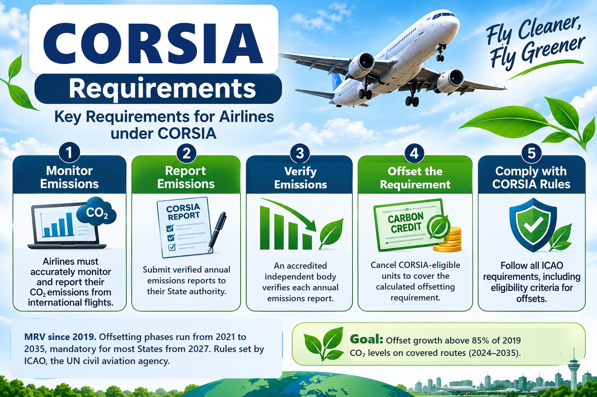

# Publishing details

**SEO Title:** CORSIA Requirements: Airline Compliance and Offsetting Guide

**Meta Description:** CORSIA requirements explained: who must comply, monitoring, reporting and verification rules, how offsetting is calculated, eligible units and key deadlines.

**URL Slug:** corsia-requirements-airline-compliance-guide

**Primary Keyword:** CORSIA Requirements

**Secondary Keywords:** CORSIA Compliance Requirements, CORSIA Requirements for Airlines, ICAO CORSIA Requirements, CORSIA Carbon Credits, CORSIA Eligible Emissions Units, CORSIA Monitoring and Reporting, CORSIA Verification Requirements, CORSIA Emissions Reporting, International Aviation Carbon Offsetting

**Featured image:** corsia-requirements-featured.jpg (1536 × 1024)
**Image alt text:** Infographic of CORSIA requirements for airlines in five steps: monitor emissions, report emissions, verify emissions, offset the requirement and comply with CORSIA rules.

**Backlink:** one contextual link, anchor "CORSIA Carbon Credits", to https://corsiacarboncredit.in/ (in the section "Eligible Emissions Units and Approved Carbon Credits").

---

# CORSIA Requirements: A Complete Guide to Airline Compliance and Carbon Offsetting

## Introduction to CORSIA Requirements

Ask a compliance manager at an international airline what CORSIA means for them, and the answer is rarely "buying carbon credits". It is a calendar of obligations: a monitoring plan approved before the year starts, fuel data collected on every international flight, a verified report each spring, and, for some routes and some years, a stack of eligible units cancelled before a hard deadline.

This guide sets out those **CORSIA requirements** as a practical checklist. It explains who has to comply, what each obligation involves, and why two airlines flying similar networks can face very different obligations.

## What Is CORSIA and Why Is It Important?

**CORSIA**, the **Carbon Offsetting and Reduction Scheme for International Aviation**, is the global market-based measure adopted by the **International Civil Aviation Organization (ICAO)** in 2016. The **ICAO CORSIA requirements** are set out in **Annex 16, Volume IV** to the Chicago Convention, supported by ICAO implementation documents.

It matters because:

- it is the **main global climate rule** for international flights, which fall outside national Paris Agreement targets
- it applies across ICAO's Member States, giving airlines **one framework** instead of many national schemes
- its offsetting obligations are **growing**, as participation becomes mandatory for most States from **2027**

CORSIA has two layers of obligation:

- **Monitoring, reporting and verification (MRV)**, which applies to all covered airlines
- **Offsetting**, which applies only to emissions on certain routes

Understanding the difference between the two is the key to understanding **CORSIA requirements for airlines**.

## Who Needs to Comply with CORSIA?

### Airlines subject to MRV

An aeroplane operator must meet **CORSIA monitoring and reporting** requirements if it:

- operates **international flights**, meaning flights between two different States
- emits **more than 10,000 tonnes of CO₂ a year** from those flights
- uses aeroplanes with a maximum take-off mass **above 5,700 kg**

### Flights that are excluded

- **domestic flights**, within a single State
- **humanitarian, medical and firefighting** flights
- flights by aeroplanes at or below the 5,700 kg threshold

### Who must offset

Offsetting applies only to emissions on routes **between two States that both participate** in CORSIA's offsetting for that year. It also does not apply to:

- **new entrants**, for their first three years or until they reach 0.1% of total international revenue tonne kilometres
- operators below the MRV threshold

### Why obligations differ

Two airlines with similar fleets can have very different obligations:

- **Airline A** flies mostly between participating States, so most of its emissions count towards offsetting.
- **Airline B** flies mainly to non-participating States, so it monitors and reports, but has a much smaller offsetting requirement.

**Applicability depends on the CORSIA rules, the States involved, route coverage and exemptions.**

## Key CORSIA Requirements for International Airlines

The core **CORSIA compliance requirements** can be summarised as a checklist:

- **Have an Emissions Monitoring Plan** approved by the national authority.
- **Monitor fuel use** on every international flight, using an approved method.
- **Calculate CO₂ emissions** using ICAO's fuel conversion factors.
- **Submit an annual Emissions Report**, verified by an accredited verification body.
- **Receive an offsetting requirement** from the national authority, if any routes are covered.
- **Claim any reductions from CORSIA eligible fuels**, with supporting evidence.
- **Cancel CORSIA Eligible Emissions Units** to cover the final requirement before the deadline.
- **Submit an Emissions Unit Cancellation Report.**

Each step is explained below.

## CORSIA Monitoring, Reporting and Verification (MRV)

MRV has applied since **1 January 2019**, regardless of whether an airline's State participates in offsetting. It builds the emissions record on which offsetting is later calculated.

The three parts:

- **Monitoring:** collecting fuel data on each international flight, following the approved plan.
- **Reporting:** compiling annual emissions totals, broken down by State pair.
- **Verification:** an independent check of the data and calculations before submission.

National authorities oversee MRV for their airlines and pass verified data to ICAO.

## Airline Emissions Monitoring and Calculation Requirements

### The Emissions Monitoring Plan

Before monitoring begins, each airline submits an **Emissions Monitoring Plan** to its national authority. The plan explains:

- the airline's fleet and operations
- which **fuel use monitoring method** it will use
- how it will manage data gaps and quality

ICAO allows several approved fuel monitoring methods, based for example on fuel measured at departure and arrival, or on fuel uplifted. Smaller emitters may use ICAO's **CORSIA CO₂ Estimation and Reporting Tool (CERT)**, within set thresholds.

### Calculating emissions

> **CO₂ emissions = Fuel used × Fuel conversion factor**

For **Jet-A and Jet-A1** fuel, ICAO's factor is **3.16 tonnes of CO₂ per tonne of fuel**. For example, 25,000 tonnes of Jet-A1 burned on international flights would produce 25,000 × 3.16 = **79,000 tonnes of CO₂** (illustrative figures).

Accuracy matters. Errors in fuel data feed straight into the offsetting calculation.

## CORSIA Emissions Reporting and Verification Process

### CORSIA emissions reporting

After each year, the airline prepares an **Emissions Report** covering:

- total CO₂ from international flights
- emissions broken down by **State pair**, which is essential for identifying covered routes
- any claims for **CORSIA eligible fuels**

Airlines generally submit the verified report to their national authority by **30 April** of the following year.

### CORSIA verification requirements

- Verification must be carried out by a **verification body accredited** under the relevant ISO standards for greenhouse gas validation and verification.
- The verifier checks the data, methods and calculations against the monitoring plan.
- Material errors must be corrected before the report is accepted.

The national authority then reviews the report and shares aggregated data with ICAO.

## Carbon Offsetting Requirements Under CORSIA

**International aviation carbon offsetting** under CORSIA does not cover all emissions. It covers a share of emissions **growth above a baseline**.

### The baseline

For 2024 to 2035, the baseline is **85% of 2019 CO₂ emissions** from international aviation.

### The calculation

The national authority calculates each airline's offsetting requirement:

1. Take the airline's emissions on **routes between participating States**.
2. Multiply them by a **growth factor**:
   - the **sectoral growth factor** reflects the whole sector's growth above the baseline, published by ICAO each year
   - the **individual growth factor** reflects the airline's own growth
   - under current rules, the requirement is based **fully on the sectoral factor until 2032**, then **85% sectoral and 15% individual** from 2033 to 2035
3. Subtract **emissions reductions from CORSIA eligible fuels**, such as qualifying sustainable aviation fuel.

### Illustrative example (hypothetical figures)

- Emissions on covered routes in a year: **150,000 tonnes**
- Assumed sectoral growth factor: **0.05**
- Gross requirement: 150,000 × 0.05 = **7,500 tonnes**
- Eligible fuel reduction claimed: **500 tonnes**
- Final requirement: **7,000 tonnes**, so 7,000 eligible units must be cancelled

*These values are for illustration only, not actual ICAO factors.*

## Eligible Emissions Units and Approved Carbon Credits

An offsetting requirement can only be met with **CORSIA Eligible Emissions Units**. Each generally represents **one tonne of CO₂ equivalent** reduced or removed by a project.

To be eligible, a unit must satisfy:

**Programme approval**

- The carbon-crediting programme must be approved by the **ICAO Council**, on the advice of the **Technical Advisory Body**, for the relevant compliance period.
- Approvals are based on ICAO's **Emissions Unit Eligibility Criteria**, covering additionality, quantification, permanence, double-counting prevention and safeguards.

**Unit conditions**

For the **first phase (2024–2026)**, these generally include:

- activities that started on or after **1 January 2016**
- vintages from **2021 to 2026**
- **host-country authorisation** with a **corresponding adjustment**
- a **CORSIA label** in the programme registry

Ordinary carbon credits do not automatically qualify. Eligible supply has also been limited: IATA estimated first-phase demand at **200–250 million units**, against about **72 million units** covered by compatible host-country authorisations in August 2026. For airlines planning their purchases, guidance on [CORSIA Carbon Credits](https://corsiacarboncredit.in/) explains how eligible units are identified, checked and documented before cancellation.

**Cancellation and reporting:** airlines cancel units in the programme's registry, then submit an **Emissions Unit Cancellation Report** to their national authority.

## CORSIA Compliance Phases and Implementation Timeline

- **2019:** MRV begins for all covered airlines.
- **2021–2023, pilot phase:** offsetting with **voluntary** State participation.
- **2024–2026, first phase:** offsetting with **voluntary** State participation. More than 100 States volunteered.
- **January 2028:** deadline for cancelling units for the **2024–2026 compliance period**.
- **2027–2035, second phase:** participation becomes **mandatory** for States with significant shares of international aviation. Least developed countries, small island developing states and landlocked developing countries are exempt unless they volunteer.
- **2027–2029:** the first compliance period of the second phase.

**Voluntary versus mandatory phases matter.** During voluntary phases, a State chooses whether its routes count. From 2027, most large aviation States must participate, which brings many more routes into offsetting. India, for example, did not volunteer for earlier phases but faces offsetting requirements from 2027.

## Common Challenges in Meeting CORSIA Requirements

- **Data quality:** incomplete fuel records lead to estimates and verification findings.
- **Route complexity:** tracking which State pairs are covered in each year.
- **Changing participation:** the list of participating States changes over time.
- **Limited eligible supply:** few units have the required host-country authorisation.
- **Price volatility:** first-phase units were assessed at about US$19 in January 2026 and US$13 in November 2026 (Fastmarkets).
- **Due diligence:** checking every unit's programme, vintage, authorisation and label.
- **Deadline pressure:** units must be cancelled before the period's deadline.
- **Evolving rules:** ICAO reviews requirements and unit conditions for each phase.

## How Airlines Can Prepare for CORSIA Compliance

- **Keep monitoring plans up to date** when fleets or operations change.
- **Strengthen fuel data systems** to reduce gaps and errors.
- **Engage verifiers early** to resolve issues before deadlines.
- **Track participating States** and map which routes will be covered from 2027.
- **Estimate future requirements**, using ICAO growth factors and network plans.
- **Plan unit procurement early**, through a mix of spot purchases and forward agreements.
- **Build a due diligence checklist** for every unit: programme approval, vintage, Letter of Authorisation, label and registry record.
- **Consider eligible fuels**, which can reduce offsetting requirements.
- **Assign clear responsibility** internally for MRV, procurement and cancellation reporting.

## Conclusion

**CORSIA requirements** are best understood as a sequence of obligations rather than a single purchase. Every covered airline must **monitor, report and verify** its international emissions each year. Only some routes, those between participating States, create an **offsetting requirement**, calculated from growth above the 2019-based baseline and reduced by eligible fuels. That requirement is met only by cancelling **CORSIA Eligible Emissions Units** that pass ICAO's programme and unit-level tests.

With mandatory participation starting in 2027, obligations will grow for many airlines. Those that invest now in accurate data, early planning and careful unit due diligence will find compliance far easier when it matters most.

---

### Sources

- [ICAO – CORSIA Eligible Emissions Units](https://www.icao.int/CORSIA/corsia-eligible-emissions-units)
- [EASA – ICAO Carbon Offsetting and Reduction Scheme for International Aviation (CORSIA)](https://www.easa.europa.eu/en/domains/environment/icao-carbon-offsetting-and-reduction-scheme-international-aviation-corsia)
- [IATA – CORSIA fact sheet](https://www.iata.org/en/iata-repository/pressroom/fact-sheets/fact-sheet-corsia/)
- [ICCT – India aviation emissions inventory and CORSIA (working paper, September 2026)](https://theicct.org/wp-content/uploads/2026/08/ID-628-%E2%80%93-India-CORSIA_working-paper_final.pdf)
- [IATA / EuropaWire – ICAO joins alliance to address CORSIA supply shortfall (13 October 2026)](https://news.europawire.eu/icao-joins-iata-backed-alliance-to-address-corsia-emissions-unit-supply-shortfall/eu-press-release/2026/10/13/18/41/08/182827/)
- [Fastmarkets – CORSIA prices tick higher on increased buyer inquiries (November 2026)](https://www.fastmarkets.com/insights/corsia-prices-tick-higher-on-increased-buyer-inquiries-despite-overall-airline-buying-remaining-measured/)
