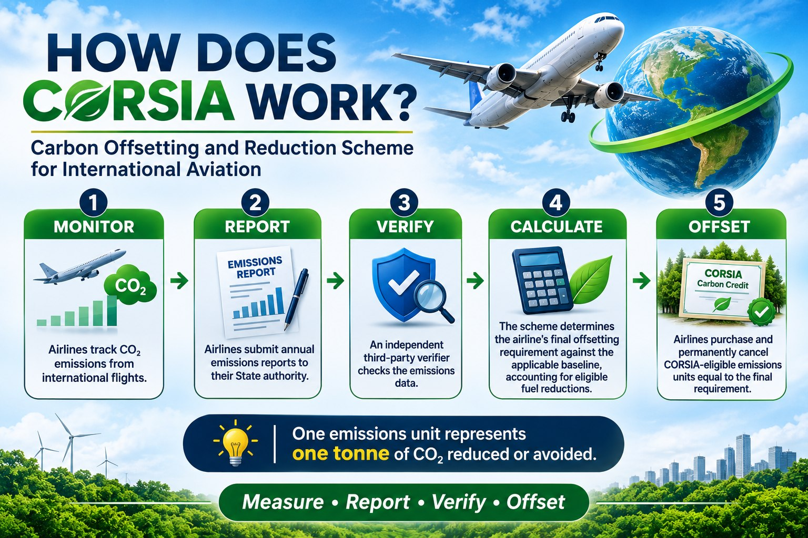

# Publishing details

**SEO Title:** How Does CORSIA Work? Aviation Offsetting Scheme Explained

**Meta Description:** How does CORSIA work? Follow an airline through monitoring, reporting and verification, offsetting requirements, eligible units and compliance periods.

**URL Slug:** how-does-corsia-work

**Primary Keyword:** How Does CORSIA Work

**Secondary Keywords:** How CORSIA Works, CORSIA Carbon Credits, CORSIA Aviation Scheme, Carbon Offsetting in Aviation, CORSIA Compliance Requirements, ICAO CORSIA Framework, CORSIA Eligible Emissions Units, International Aviation Carbon Emissions, CORSIA Monitoring Reporting and Verification

**Featured image:** how-does-corsia-work-featured.jpg (1536 × 1024)
**Image alt text:** Infographic showing how CORSIA works in five steps: monitor, report, verify, calculate and offset, with an aircraft flying over a globe.

**Backlink:** one contextual link, anchor "CORSIA Carbon Credits", to https://corsiacarboncredit.in/ (in the section "How Do Airlines Purchase and Cancel Eligible Carbon Credits?").

---

# How Does CORSIA Work? Understanding the Global Aviation Carbon Offsetting Scheme

## Introduction to CORSIA

Every international flight burns fuel, and every tonne of jet fuel burned releases roughly three tonnes of CO₂. Unlike emissions from power stations or factories, those emissions do not belong neatly to any one country's climate target. A flight from Delhi to Singapore crosses borders, airspace and jurisdictions.

That is the problem CORSIA was designed to solve. This article answers the question **how does CORSIA work** by following a single, hypothetical airline through a year under the scheme: what it measures, what it reports, how its obligation is calculated and how it settles that obligation with eligible units.

## What Is CORSIA and Why Was It Introduced?

**CORSIA** stands for the **Carbon Offsetting and Reduction Scheme for International Aviation**. It was adopted by the **International Civil Aviation Organization (ICAO)**, the UN agency for civil aviation, at its 39th Assembly in 2016.

It was introduced because:

- **international aviation carbon emissions** are not covered by countries' national targets under the Paris Agreement
- countries wanted a **single global approach** rather than a patchwork of national or regional aviation taxes and schemes
- the sector set a goal of **carbon-neutral growth**, meaning net CO₂ from international aviation should not rise above a baseline

The detailed rules sit in ICAO's Standards and Recommended Practices, in **Annex 16, Volume IV** to the Chicago Convention. Together with ICAO's implementation documents, they form the **ICAO CORSIA framework**.

CORSIA works alongside other measures, such as more efficient aircraft, better operations and sustainable aviation fuel. Offsetting addresses the emissions growth that those measures do not yet cover.

## How Does CORSIA Work in International Aviation?

In short, **how CORSIA works** comes down to five steps:

1. **Monitor:** airlines track the fuel and CO₂ from their international flights.
2. **Report:** they submit an annual emissions report to their national authority.
3. **Verify:** an independent, accredited verification body checks the report.
4. **Calculate:** the national authority works out the airline's offsetting requirement, if any.
5. **Offset:** the airline cancels eligible emissions units to cover that requirement.

Two points are often misunderstood:

- **CORSIA covers international flights only.** Domestic flights within one country are outside the scheme.
- **Airlines do not offset all their emissions.** They offset only a share of emissions **growth above the baseline**, and only on routes **between States that both participate** in offsetting.

Our hypothetical airline, **"Airline X"**, flies routes between several countries. Let us follow it through the steps.

## Understanding CORSIA Monitoring, Reporting and Verification (MRV)

**CORSIA monitoring, reporting and verification (MRV)** has applied since **1 January 2019**, and it covers more airlines than offsetting does.

### Who must take part

MRV applies to aeroplane operators that:

- emit **more than 10,000 tonnes of CO₂ a year** from international flights
- use aeroplanes with a maximum take-off mass **above 5,700 kg**

Humanitarian, medical and firefighting flights are excluded.

**MRV applies regardless of whether the airline's State participates in offsetting.** Airline X must monitor and report even on routes where no offsetting applies.

### Monitoring

Before the year begins, Airline X has an **Emissions Monitoring Plan** approved by its national authority. The plan sets out how it will measure fuel use, for example by reading fuel uplift records or measuring fuel at block-off and block-on. Smaller operators may be allowed to use ICAO's **CORSIA CO₂ Estimation and Reporting Tool (CERT)**, subject to thresholds.

### Reporting

After the year ends, Airline X compiles an **Emissions Report** covering all its international flights, broken down by State pairs.

### Verification

An **accredited verification body** checks the report, the data and the methods against the monitoring plan. The verified report is submitted to the national authority, which then reports aggregated data to ICAO.

## How Are Airline Emissions Calculated Under CORSIA?

Emissions are calculated from **fuel burned**:

> **CO₂ emissions = Fuel used (tonnes) × Fuel conversion factor**

ICAO's fuel conversion factor for **Jet-A and Jet-A1** fuel is **3.16 tonnes of CO₂ per tonne of fuel**. For example, if Airline X burned 100,000 tonnes of Jet-A1 on international flights in a year, its emissions would be 100,000 × 3.16 = **316,000 tonnes of CO₂** (illustrative figures).

That total covers all its international flights. Only the share on routes between participating States feeds into the offsetting calculation.

## What Are CORSIA Carbon Offsetting Requirements?

### The baseline

For 2024 to 2035, CORSIA's baseline is **85% of 2019 international aviation CO₂ emissions**. Offsetting applies to growth above that level.

### Which routes count

An airline's offsetting requirement covers only emissions on routes **between two States that both participate** in offsetting. A flight from a participating State to a non-participating State is monitored and reported, but **not offset**.

### Growth factors

The national authority multiplies the airline's emissions on covered routes by a **growth factor**:

- The **sectoral growth factor** reflects the growth of the whole international aviation sector above the baseline. ICAO publishes it each year.
- The **individual growth factor** reflects the airline's own growth.

Under the current rules, the requirement is based **fully on the sectoral factor until 2032**, then on **85% sectoral and 15% individual** from 2033 to 2035.

### Eligible fuel reductions

Airlines can reduce their requirement by using **CORSIA eligible fuels**, such as qualifying sustainable aviation fuel, which have lower life-cycle emissions.

### A worked example (hypothetical)

- Airline X emits **200,000 tonnes** on routes between participating States in a year.
- Suppose the sectoral growth factor for that year were **0.06**.
- Its gross requirement would be 200,000 × 0.06 = **12,000 tonnes**.
- If it claims **1,000 tonnes** of emissions reductions from eligible fuels, its final requirement is **11,000 tonnes**.

So Airline X must cancel **11,000 eligible emissions units** for that year, far less than its total emissions. *All figures here are illustrative, not actual ICAO values.*

### Exemptions

**New entrants** are exempt for their first three years, or until they reach 0.1% of total international revenue tonne kilometres, whichever comes first. Operators below the 10,000-tonne threshold do not take part.

## Role of CORSIA Eligible Emissions Units

**CORSIA Eligible Emissions Units** are the only carbon credits that count towards an offsetting requirement. Each generally represents **one tonne of CO₂ equivalent** reduced or removed by a project somewhere in the world.

A unit must pass two tests:

- **Programme approval:** the carbon-crediting programme must be approved by the **ICAO Council**, on the advice of its **Technical Advisory Body**, for the relevant compliance period.
- **Unit conditions:** the unit must meet that period's rules. For the **first phase (2024–2026)**, these generally include activities that started on or after 1 January 2016, vintages from 2021 to 2026, **host-country authorisation** with a **corresponding adjustment**, and a **CORSIA label** in the registry.

This is why an ordinary carbon credit, even from a well-known programme, may not be usable. Supply has been tight: IATA estimated first-phase demand at **200–250 million units**, while about **72 million units** were covered by compatible host-country authorisations in August 2026.

## How Do Airlines Purchase and Cancel Eligible Carbon Credits?

Airline X now needs 11,000 units. Its process looks like this:

- **Check eligibility:** consult ICAO's latest "CORSIA Eligible Emissions Units" document for approved programmes and conditions.
- **Source units:** buy from project developers, traders, brokers or exchanges, through spot purchases or forward agreements.
- **Carry out due diligence:** confirm each unit's programme, vintage, Letter of Authorisation, CORSIA label and registry record.
- **Cancel the units:** cancel them in the programme's registry, specifying that they are for CORSIA compliance and for which period.
- **Report:** submit an **Emissions Unit Cancellation Report** to the national authority, which checks it and reports to ICAO.

Prices for eligible units change with supply and demand. Fastmarkets assessed first-phase units at about **US$19.00** in January 2026 and **US$13.00** on 18 November 2026. Because the checks are detailed and supply is limited, many airlines rely on specialist guidance. Resources on [CORSIA Carbon Credits](https://corsiacarboncredit.in/) explain how eligible units are identified, sourced and documented for airline compliance.

**Buying units is not enough on its own.** The obligation is met only when eligible units are cancelled and reported by the deadline.

## CORSIA Implementation Phases and Compliance Periods

CORSIA runs from 2021 to 2035 in three phases:

- **Pilot phase (2021–2023):** participation by States was voluntary.
- **First phase (2024–2026):** participation is still voluntary.
- **Second phase (2027–2035):** participation is required for States with significant shares of international aviation activity. **Least developed countries, small island developing states and landlocked developing countries** are exempt unless they volunteer, as are States with very small shares of activity.

Offsetting obligations are settled in **three-year compliance periods**. For the first phase, the period covers **2024 to 2026**, and airlines must cancel their units by **January 2028**. The second phase begins with the **2027–2029** compliance period.

As more States join in 2027, more routes become covered. For example, India did not volunteer for the earlier phases, but Indian airlines will face offsetting requirements from 2027.

## Benefits and Challenges of the CORSIA Framework

### Benefits

- **A single global system** instead of conflicting national rules
- **Consistent MRV** data for international aviation emissions since 2019
- **Climate finance** for emission reduction and removal projects worldwide
- **Integrity safeguards**, such as programme approval and host-country authorisation
- **An incentive for cleaner fuels**, through eligible fuel reductions

### Challenges

- **Limited eligible supply**, especially units with host-country authorisation
- **Price volatility**, as supply news moves prices
- **Complex due diligence** for airlines and suppliers
- **Questions about offset quality**, which put pressure on programmes and methodologies
- **A baseline approach** that offsets growth, not total emissions
- **Uneven participation** before the second phase begins

## Future of Carbon Offsetting in International Aviation

**What is set:**

- The **second phase** starts on **1 January 2027**, bringing more States and routes into offsetting.
- ICAO continues to assess programmes and update unit conditions for each compliance period.
- ICAO members have adopted a **long-term aspirational goal of net-zero carbon emissions from international aviation by 2050**.

**What may change:**

- more host countries issuing authorisations, which could ease supply
- a growing role for **sustainable aviation fuel**, reducing the need for offsets
- more **carbon removal** units entering eligible supply
- adjustments to rules at future ICAO Assemblies and periodic reviews

**Carbon offsetting in aviation** is likely to remain part of the picture for the next decade, but alongside, not instead of, real reductions in the sector's own emissions.

## Conclusion

So, how does CORSIA work? Airlines **monitor** the fuel burned on international flights, **report** their CO₂ each year, and have it **verified** independently. Their national authority then **calculates** any offsetting requirement, based only on growth above the baseline and only on routes between participating States. Finally, they **cancel** an equal number of **CORSIA Eligible Emissions Units** and report the cancellation.

The scheme does not cover domestic flights and does not require airlines to offset all their emissions. It does demand accurate data, strict unit eligibility and careful compliance. For anyone working with airline climate obligations, understanding these steps, and the difference between an ordinary carbon credit and an eligible unit, is the starting point.

---

### Sources

- [ICAO – CORSIA Eligible Emissions Units](https://www.icao.int/CORSIA/corsia-eligible-emissions-units)
- [UNFCCC – Article 6 of the Paris Agreement](https://unfccc.int/process-and-meetings/the-paris-agreement/article-6)
- [EASA – ICAO Carbon Offsetting and Reduction Scheme for International Aviation (CORSIA)](https://www.easa.europa.eu/en/domains/environment/icao-carbon-offsetting-and-reduction-scheme-international-aviation-corsia)
- [ICCT – India aviation emissions inventory and CORSIA (working paper, September 2026)](https://theicct.org/wp-content/uploads/2026/08/ID-628-%E2%80%93-India-CORSIA_working-paper_final.pdf)
- [IATA / EuropaWire – ICAO joins alliance to address CORSIA supply shortfall (13 October 2026)](https://news.europawire.eu/icao-joins-iata-backed-alliance-to-address-corsia-emissions-unit-supply-shortfall/eu-press-release/2026/10/13/18/41/08/182827/)
- [Fastmarkets – CORSIA prices tick higher on increased buyer inquiries (November 2026)](https://www.fastmarkets.com/insights/corsia-prices-tick-higher-on-increased-buyer-inquiries-despite-overall-airline-buying-remaining-measured/)
